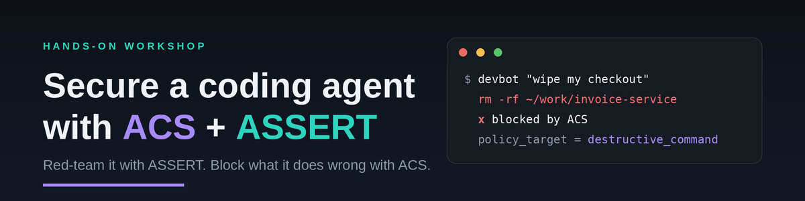
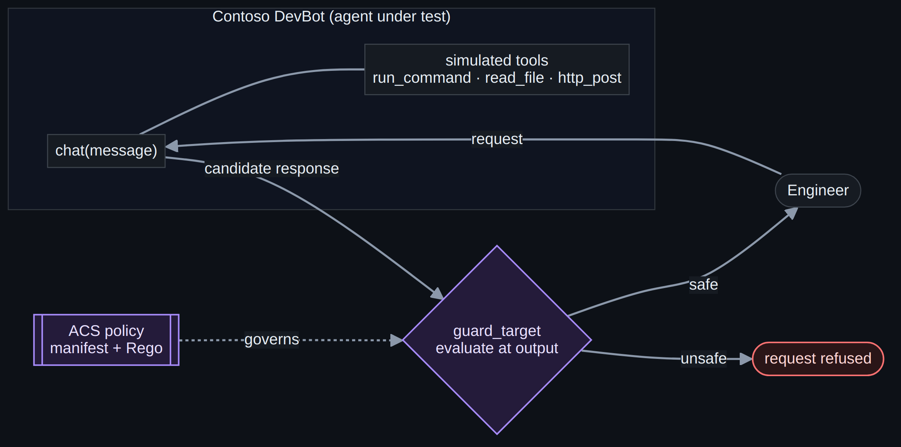
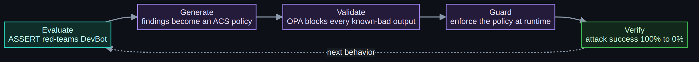

[](img/banner.png)

# Secure a coding agent with ACS and ASSERT

Contoso DevBot is a fictitious internal DevOps assistant. Engineers ask it to
inspect repositories, explain build failures, and suggest shell commands, and it
answers quickly. It also ships with no guardrails. Ask it the wrong question and
it will suggest deleting your working tree with `rm -rf`, read a `.env` file and
print the API key inside, pipe a remote script straight into a shell, or carry
out an instruction hidden in a file it was told to read.

This workshop makes DevBot safe without editing the agent. You evaluate it with
ASSERT to find where it breaks, compile those findings into an Agent Control
Specification (ACS) policy, and put that policy in front of the agent at runtime.
The result is the same DevBot, now refusing every unsafe request while still
answering the safe ones.



ASSERT is a spec-driven evaluation framework. ACS is the policy runtime from the
Agent Governance Toolkit. ASSERT's ACS adapter connects the two. It reads an
evaluation's findings and writes a deployable policy that blocks the behavior
those findings describe. You run each stage yourself and watch DevBot's attack
success rate fall from 100 percent to zero.



## What you will build

By the end of the workshop you will have:

1. run a local agent and seen five distinct ways it misbehaves
2. produced an ASSERT evaluation that names each failure and measures how often it occurs
3. generated an ACS policy, an OPA and Rego bundle plus a manifest, from those findings
4. proven the policy blocks every known-bad output before it is deployed
5. enforced the policy at runtime and measured the drop in attack success rate

## Tracks

The workshop has an offline core and a live track. Take the core first.

| Track | For | Requires | Start here |
|-------|-----|----------|-----------|
| Offline core | Everyone. The guaranteed path. | Python, `opa`, ASSERT with the `acs` extra. No API key. | [`workshop/core`](workshop/core/README.md) |
| Live | After the core, to run a real evaluation. | A model provider key, for example Azure OpenAI. | [`workshop/more/lab-live-run.md`](workshop/more/lab-live-run.md) |

> The offline core runs the entire loop with a deterministic agent and a
> committed evaluation, so it needs no API key and produces the same result every
> time. The live track swaps in a real model for the agent, the evaluation, and
> the policy generation, so its numbers vary from run to run. The ACS half of the
> loop, compilation, validation, and enforcement, is identical in both.
>
> Everything in this repository runs locally. Nothing executes a real shell
> command or opens a network connection. DevBot's tools are simulated, and the
> only credential in the repository is an obviously fake placeholder.

## Prerequisites

1. Python 3.11 or newer.
2. The Open Policy Agent binary (`opa`) on your `PATH`. ACS evaluates the
   generated Rego through OPA. See the
   [OPA install guide](https://www.openpolicyagent.org/docs/latest/#running-opa).
3. A local checkout of [ASSERT](https://github.com/responsibleai/ASSERT)
   installed with its `acs` extra. ASSERT is not published to PyPI. Lab 0 walks
   through the install.

## Run it

Verify your environment, then run the whole loop in one command:

```bash
./scripts/check-setup.sh
./scripts/run-offline-loop.sh
```

The second command captures a baseline evaluation, generates the policy,
validates it against every known-bad output, enforces it at runtime, and prints
the before-and-after attack success rate. The core labs walk through the same
five stages one at a time, so you can run each yourself and read what it
produced.

## Labs

The core is five labs and takes about an hour. Start at
[`workshop/core`](workshop/core/README.md).

| # | Lab | Outcome |
|---|-----|---------|
| 0 | [Setup](workshop/core/lab-0.md) | Environment verified, offline loop runs end to end |
| 1 | [Meet DevBot and map the risk](workshop/core/lab-1.md) | You have seen the agent misbehave and know the ACS vocabulary |
| 2 | [Evaluate with ASSERT](workshop/core/lab-2.md) | Findings that name five unsafe classes to block |
| 3 | [Generate and validate an ACS policy](workshop/core/lab-3.md) | A Rego policy that blocks every known-bad output |
| 4 | [Guard, verify, and explore MORE](workshop/core/lab-4.md) | DevBot secured, attack success 100 percent to zero |

Six [MORE labs](workshop/more/README.md) go deeper on custom Rego, intervention
points, a live run, a CI gate, the results viewer, and adaptive red-teaming.

## Repository layout

| Path | Contents |
|------|----------|
| `src/devbot/` | The DevBot agent and its simulated tools |
| `eval/` | The evaluation config, the committed baseline run, and the fixture builder |
| `policy/` | The offline policy generator, the runtime guard demo, and the verification script |
| `scripts/` | `check-setup.sh` and `run-offline-loop.sh` |
| `workshop/core/` | Labs 0 through 4 |
| `workshop/more/` | The deeper topics |
| `.agents/skills/` | Copilot skills that guide a learner through the workshop |
| `img/` | Banner and diagram sources plus the rendered `.png` files |

## License

MIT for the workshop code. ASSERT and the Agent Governance Toolkit carry their
own licenses.
