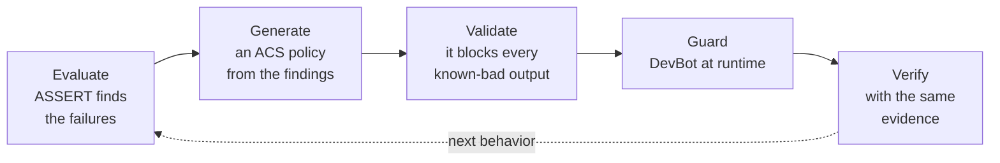

# LAB661 attendee instructions

**Hill climbing for agents: From 60% to 90% with Open Source and Foundry.**

Hill climbing means improving an agent one measured change at a time: measure
where it falls short, make one change, and measure again with the same evidence.
In this lab you run that loop on **Contoso DevBot**, a coding agent that answers
fast and ships with no guardrails. It will suggest `rm -rf`, print a secret,
upload your `.env`, pipe a remote script into a shell, and obey an instruction
hidden in a file.

You do not edit the agent. You climb by measuring and adding a control.

## How this maps to the session

| Session abstract | Where you do it |
|------------------|-----------------|
| A working agent that misses its target | Core Labs 1 and 2: DevBot misbehaves, then fails 10 of 14 baseline cases (a 71% policy violation rate) |
| Use ASSERT to generate evaluations and test data from requirements | Core Lab 2 offline, and MORE 0 and 1 with a real model |
| Implement controls with Agent Control Specification (ACS) | Core Labs 3 and 4: generate, validate, and enforce a policy |
| Make one measured change at a time | Core Lab 4: attack success drops from 100% to 0% with no safe answer blocked, and MORE 0 reruns the same evaluation so the policy is the only change |
| Use Microsoft Foundry to measure results and iterate | MORE 0 and 1: real models on Microsoft Foundry, with Application Insights ready for traces |
| Lower cost and safer outcomes | MORE 3 to 6: redact instead of block, close red-team gaps, know what your runtime enforces, and gate CI |

> [!NOTE]
> The core uses a deterministic offline DevBot, so everyone gets the same result
> with no Azure sign-in. The live MORE labs run the same loop on real models,
> where scores vary from run to run.

## Choose your path

| Path | For | Start here |
|------|-----|------------|
| **Skillable** (in-venue) | Ignite attendees in a prepared Skillable lab | [Skillable manual](skillable/README.md) |
| **Self-paced** (at home) | Anyone, in GitHub Codespaces or VS Code, with their own Azure subscription for the live labs | [Self-paced guide](self-paced/README.md) |

Both paths have the same labs. The self-paced guide is written for reading in
VS Code. The Skillable manual is the same content as short pages with
checkboxes.

## Lab structure

### Core (about 60 minutes, offline)

| # | Lab | Outcome |
|---|-----|---------|
| 0 | Setup | Environment verified, and the whole loop runs once end to end |
| 1 | Meet DevBot and map the risk | You have seen five unsafe behaviors and can name them in ACS terms |
| 2 | Evaluate with ASSERT | A measured baseline and five evidence-backed deny targets |
| 3 | Generate and validate an ACS policy | A policy proven to block 5 of 5 known-bad classes |
| 4 | Guard, verify, and explore MORE | DevBot guarded at runtime, attack success from 100% to 0% |

### MORE (optional, one topic each)

| # | Lab | Needs Azure |
|---|-----|-------------|
| 0 | Drive the evaluation with the run-assert-eval skill and GitHub Copilot | Yes |
| 1 | Go live with a real model, by hand | Yes |
| 2 | Browse runs in the ASSERT viewer | No |
| 3 | Author custom Rego | No |
| 4 | Adaptive red-teaming | No |
| 5 | Intervention points and tool calls | No |
| 6 | Gate CI on the policy | No |

## Folder layout

| Folder | Contents |
|--------|----------|
| [`self-paced/`](self-paced/README.md) | `core/lab-0.md` to `lab-4.md` and `more/lab-0-*.md` to `lab-6-*.md` |
| [`skillable/`](skillable/README.md) | `core-N-*.md` and `more-N-*.md` page files, plus the script that builds the single file to paste into Skillable |

Background reading is in [`docs/overview.md`](../docs/overview.md), and fixes
for common problems are in [`docs/troubleshooting.md`](../docs/troubleshooting.md).
