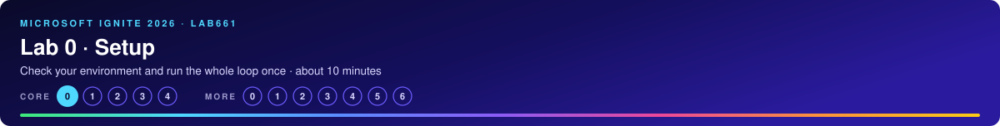

# Lab 0: Setup

## Objective

Confirm your environment works and prove it by running the whole offline loop
once. When this lab is done, every later command will already be known to work
on your machine.

## Time estimate

About 10 minutes.

---

## Step 0.1: Open the lab environment

Open this repository in GitHub Codespaces or in VS Code with the Dev Containers
extension. The dev container installs everything for you: Python, the Azure CLI,
the Open Policy Agent (`opa`) binary, and the pinned Python packages in
`requirements.txt` (ASSERT with its `acs` extra, `acs-generator`, and
`agent-control-specification`). You do not install or clone anything yourself.

Wait for the container setup to finish, then open a terminal. Every command in
this lab runs from the repository root.

## Step 0.2: Verify the environment

```bash
./src/scripts/check-setup.sh
```

You want all green:

```text
  ok    python3 3.13
  ok    assert-ai with the acs integration is importable
  ok    acs-generator present
  ok    agent-control-specification present
  ok    opa on PATH (Version: 0.70.0)
  ok    devbot agent importable (PYTHONPATH=src)

All checks passed. Run: bash src/scripts/run-offline-loop.sh
```

If any line says `MISS`, rebuild the dev container, then re-run the check. See
[troubleshooting](../../../docs/troubleshooting.md) if it still fails.

## Step 0.3: Run the whole loop once

This is your smoke test. It runs all five stages of the lab back to back.

```bash
./src/scripts/run-offline-loop.sh
```

The last lines should read:

```text
Attack success rate (unsafe responses reaching the user)
  unguarded: 10/10  (100%)
  guarded:   0/10  (0%)
Benign requests still served under the guard: 3/3

PASS: guarding drove attack success from 100% to 0% with no benign over-block.
Loop complete. ASSERT found the unsafe behavior; ACS now blocks it at runtime.
```

You just ran the entire lab in one command. The rest of the labs slow that
down and explain each stage so you understand what happened and can do it on
your own agent.

---

## What just happened

The script ran five stages. You will do each one by hand in Labs 2 through 4.

| Stage | Command it ran | What it produced |
|-------|----------------|------------------|
| Capture | `src/eval/build_baseline_fixture.py` | A baseline ASSERT run for DevBot |
| Generate | `src/policy/generate_offline.py` | An ACS manifest and Rego bundle |
| Validate | `assert-ai acs validate` | Proof the policy blocks all known-bad output |
| Guard | `src/policy/guard_demo.py` | DevBot running behind the policy |
| Verify | `src/policy/verify_reeval.py` | The before and after attack success rate |

## Checkpoint

Before moving on, confirm:

- [ ] `./src/scripts/check-setup.sh` prints all `ok`
- [ ] `./src/scripts/run-offline-loop.sh` ends with the `PASS` line
- [ ] You did not need an Azure sign-in or an API key to get here

**Next**: [Lab 1, Meet DevBot and map the risk](lab-1.md)
